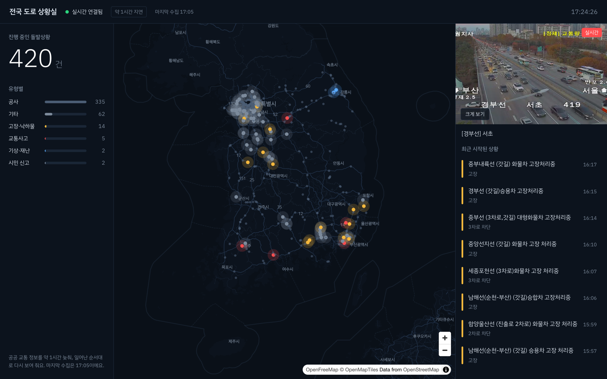

# 전국 도로 상황실

전국 고속도로와 국도에서 지금 일어나는 사고·고장·공사를 어두운 지도 위에 띄우고, 그 지점의 실제 CCTV 생방송을 바로 틀어 주는 관제 화면입니다. 데이터는 국가교통정보센터(ITS)의 공개 API에서 받습니다.

**https://traffic-room.vercel.app**



링크를 열면 지금 진행 중인 돌발상황 400여 건이 지도에 찍혀 있습니다. 왼쪽에는 유형별 건수가, 오른쪽에는 CCTV 한 대와 최근 시작된 상황 목록이 있습니다. 화면을 띄워 두면 새 상황이 하나씩 도착합니다. 도착할 때마다 목록 맨 위에 카드가 밀려 들어오고 지도에서는 그 지점에 파동이 세 번 퍼집니다. 목록의 상황을 누르면 지도가 그곳으로 옮겨 가고, 가장 가까운 CCTV로 바뀝니다. 근처 다른 CCTV로 바꿀 수 있고 **크게 보기**로 전체화면으로 볼 수도 있습니다.


상단의 **약 1시간 지연**은 숨기지 않고 늘 띄워 둡니다. 왜 1시간 늦게 보여 주는지는 아래 첫 번째 문제에 적었습니다.

## 왜 만들었나

앞선 프로젝트들은 화면을 그리는 일이 중심이었습니다. 서버가 먼저 말을 거는 실시간 화면, 브라우저에서 영상 스트림을 재생하는 일, 지도 위의 데이터 시각화는 하나도 없었습니다. 이 셋을 한 화면에 모을 수 있는 주제를 찾다가 도로 관제실을 골랐습니다. 공공 데이터라 실제 사고와 실제 CCTV를 쓸 수 있고, "살아 있는 화면"이라는 게 링크를 여는 순간 보이기 때문입니다.

처음에 정한 실패 조건이 두 개 있었습니다. 흔한 관리자 대시보드 템플릿처럼 보이면 실패입니다. 그리고 가짜 데이터를 실제인 척 보여 주면, 동작은 해도 실패로 보기로 했습니다. 아래 결정 대부분은 이 두 번째 조건 때문에 나왔습니다.

## 붙잡고 있던 문제들

### 1. 한 달에 1,000번으로 실시간 화면을 만들기

ITS API는 서비스별로 한 달에 1,000번까지만 부를 수 있습니다. 31일로 나누면 45분에 한 번이 최대입니다. 그대로 만들면 화면은 1시간 내내 멈춰 있다가 정각에 40건이 한꺼번에 바뀝니다. 그건 실시간 화면이 아니라 1시간마다 새로고침하는 표입니다.

그래서 시간을 1시간 미루기로 했습니다. 매시 수집한 돌발상황을 직전 수집과 비교해서 새로 생긴 상황을 고르고, 각 상황을 **실제 발생 시각 + 60분**에 하나씩 WebSocket으로 내보냅니다. 14:12에 난 사고는 15:12에, 14:31에 난 고장은 15:31에 도착합니다. 몰려서 오지 않고 실제로 일어난 간격 그대로 화면이 움직입니다. 대신 화면 상단에 "약 1시간 지연"을 늘 띄우고, 이벤트를 지어내서 빈 시간을 채우지는 않았습니다.

송출 시각은 서버 메모리가 아니라 DB에 저장합니다. 무료 서버는 언제든 재시작될 수 있는데, 다시 켜졌을 때 "지금 내보낼 차례"를 DB에서 다시 계산하면 이어서 내보낼 수 있습니다. 접속한 모든 사람은 같은 순간에 같은 이벤트를 받습니다.

예산은 돌발상황 월 744번, CCTV 목록 월 186번으로 짰습니다. 코드는 이번 달 호출이 950번이 되면 멈춥니다. 개발 중에는 실제 API를 한 번도 부르지 않고, 첫날 받아 둔 실제 응답을 재생해서 썼습니다.

### 2. 순서가 꼬이고, 이벤트가 사라졌다

이 프로젝트에서 가장 오래 붙잡은 부분입니다. 코드 검토에서 같은 종류의 문제가 세 번 나왔습니다.

첫 번째는 순서였습니다. 클라이언트는 받은 이벤트 번호가 마지막 번호보다 작으면 이미 본 것으로 여기고 버립니다. 그런데 한 번의 수집 안에서 DB가 매기는 번호가 송출 순서와 달라서, 먼저 도착한 이벤트가 뒤 번호를 갖는 일이 생겼습니다. 그러면 그다음에 오는 앞 번호 이벤트는 화면에 나오지 않았습니다. 번호를 송출 시각 순서로 매기고, 늦게 끝난 수집이 앞선 번호를 받지 않도록 지금까지의 최댓값보다 크게 보정했습니다.

두 번째는 재접속이었습니다. 연결이 끊겼다 다시 붙으면 클라이언트가 "마지막으로 받은 번호 이후"를 요청합니다. 그런데 서버가 그 답을 DB에서 찾는 동안 새 이벤트 브로드캐스트가 먼저 나가면, 클라이언트는 더 큰 번호를 먼저 받고 마지막 번호를 올려 버립니다. 그 뒤에 도착한 따라잡기 응답은 전부 "이미 본 것"이 되어 영영 사라졌습니다. 연결마다 순서 보장 큐를 두어 따라잡기 응답이 끝나기 전에는 새 이벤트를 붙잡아 두고, 접속 주소에 마지막 번호를 실어(`/ws?lastId=`) 연결되자마자 따라잡게 했습니다.

세 번째는 스케줄러였습니다. 실시간 서버는 DB를 30분에 한 번 읽어 "앞으로 60분 안에 내보낼 이벤트"를 가져옵니다. 문제는 그 30분 사이에 Mac이 새로 수집한 이벤트 중, 다음 읽기 전에 이미 송출 시각이 지나는 것들이었습니다. 계산해 보니 약 4분의 1이 한 번도 나가지 못하고 사라지고 있었습니다. 지난번 읽은 시각부터 다시 읽게 바꾸고, 송출 시각이 이미 지난 건 바로 내보냅니다.

세 번을 겪고 나서 원칙을 하나 정했습니다. **같은 이벤트가 두 번 오는 건 괜찮지만, 빠지는 건 안 된다.** 중복은 번호로 걸러지지만 빠진 건 아무도 모르기 때문입니다. 위 세 가지는 모두 테스트로 재현한 다음 고쳤습니다.

### 3. 배포하고 나서야 알았다: ITS는 클라우드에서 열리지 않는다

처음 설계에서 수집은 GitHub Actions 예약 실행이 맡았습니다. 무료이고, 서버가 잠들어도 수집은 이어지니까요. 배포하고 첫 수집이 `NETWORK` 오류로 끝났습니다.

진단용 워크플로를 따로 만들어 단계별로 연결해 봤더니, its.go.kr은 API 포트(9443)뿐 아니라 일반 웹 포트(443)까지 응답이 없었습니다. Actions 서버는 미국에 있으니 해외 IP를 막는 거라 보고, 수집을 Vercel의 서울 리전 함수로 옮겨 같은 진단을 돌렸습니다. AWS 서울에서도 시간 초과였습니다. 해외가 아니라 클라우드·데이터센터 IP 자체를 받지 않는 것이었습니다. 집 회선의 Mac에서는 같은 요청이 정상으로 돌아왔습니다.

대체 출처도 찾아봤습니다. 경찰청 도시교통정보센터(UTIC)는 키와 함께 접속 IP를 등록하는 방식이고, 고속도로 CCTV를 제공하지 않았습니다. 국내 유료 VPS도 데이터센터 IP라 막힐 가능성이 높았고, 가정용 IP를 빌려 주는 프록시는 접근 제한을 우회하는 방법이라 처음부터 뺐습니다.

결국 구조를 바꿨습니다. 수집은 국내 회선에 있는 제 Mac이 launchd로 매시 5분에 돌리고, Render와 Vercel은 DB만 읽습니다. 그러면 Mac이 잠들어 있는 동안은 수집이 멈춥니다. 이것도 숨기지 않기로 했습니다. 화면 상단에 `마지막 수집 17:05`를 띄우고, 3시간 넘게 새 수집이 없으면 노란색으로 "수집 일시 중지"를 붙입니다.

Mac으로 옮기면서 한 번 더 막혔습니다. launchd에 등록했는데 로그에 "Operation not permitted"만 찍혔습니다. 저장소가 바탕화면 아래에 있었는데, 바탕화면·문서·다운로드는 macOS가 따로 보호하는 폴더라 launchd가 띄운 bash는 읽을 수 없었습니다. bash에 전체 디스크 접근 권한을 주면 풀리지만 범위가 너무 넓어서, 보호 폴더 밖에 수집 전용 복사본을 두고 그걸 돌립니다.

### 4. CCTV 영상을 서버 없이 브라우저에서 바로

영상을 서버가 받아서 다시 보내 주면 트래픽 비용이 듭니다. 그래서 만들기 전에 실제 키로 CCTV 주소를 받아 단계마다 응답 헤더를 확인했습니다. `cctvType=4`로 요청하면 HTTPS HLS 주소가 나오고, 재생목록부터 3초짜리 영상 조각까지 모든 단계에 `Access-Control-Allow-Origin: *`가 붙어 있었습니다. 그래서 hls.js로 브라우저가 직접 재생하고, 영상 트래픽 비용은 0원입니다.

주소가 언제 만료되는지는 문서에 없어서 직접 쟀습니다. 발급하고 10분부터 8시간까지 일곱 번 열어 봤고, 모두 열렸습니다. 그래서 CCTV 목록은 8시간마다(하루 세 번) 새로 받습니다. 그래도 재생이 실패하면 서버에 새 주소를 한 번만 요청하고, 같은 주소가 돌아오거나 10초 안에 답이 없으면 "지금 이 CCTV를 불러올 수 없다"는 안내를 띄웁니다. 전체화면은 Fullscreen API를 쓰고, 이걸 막는 환경에서는 화면을 꽉 채우는 오버레이로 대신합니다.

### 작게 걸렸던 것들

- **지도가 브라우저에서만 비어 있었습니다.** 테스트는 모두 통과했는데 화면에서는 지도가 안 그려졌습니다. Next.js 16의 Turbopack이 MapLibre의 워커 파일 경로를 바꿔 버린 것이었습니다. 빌드할 때 워커 파일을 `public`으로 복사하고 `setWorkerUrl`로 주소를 고정했습니다.
- **배포한 순간의 데이터가 박제됐습니다.** 스냅샷 API에 `revalidate`를 걸어 뒀더니, 빌드 때 만든 응답이 그대로 구워져 나갔습니다. 요청마다 실행하게 바꾸고 캐시는 CDN 헤더(`s-maxage` 60초)로 걸었습니다. 운영에서 DB를 못 읽으면 저장해 둔 예시 데이터를 실제처럼 보여 주지 않고 503을 돌려줍니다.
- **"교통사고" 안에 포트홀 신고가 섞여 있었습니다.** 실제 응답을 열어 보니 시민이 앱으로 신고한 도로 파손이 교통사고로 분류돼 있었습니다. 화면에서는 "시민 신고"로 따로 나눕니다.
- **DB 무료 사용량.** Neon 무료 요금제는 5분 동안 쿼리가 없으면 DB가 잠들고, 깨어 있는 시간만큼 한도를 씁니다. 실시간 서버가 DB를 30분에 한 번만 읽게 한 이유가 이것입니다.
- 시스템 설정에서 "동작 줄이기"를 켜면 파동과 카드 등장 애니메이션이 멈춥니다.

## 돈을 쓰지 않고 운영하기

결제 수단을 연결해야만 돌아가는 서비스는 쓰지 않는다는 게 처음부터의 조건이었습니다.

```
[내 Mac, 국내 회선]                              [Neon Postgres]
 launchd 매시 5분 ── ITS API ──────────────────▶  돌발 · 송출 이벤트 · CCTV
                                                   ▲             ▲
                       [Render 실시간 서버] ────────┘             │ 스냅샷 API
                        30분마다 다가올 이벤트를 읽고              │
                        송출 시각에 WebSocket으로 ───────▶ [Vercel 화면] ◀── CCTV HLS를 브라우저가 직접 재생
 [cron-job.org] 10분마다 /health ──▶ Render (잠들지 않게)
```

화면은 Vercel Hobby, 실시간 서버는 Render 무료, DB는 Neon 무료, 지도는 키도 사용량 제한도 없는 OpenFreeMap 타일에 색을 직접 손본 스타일입니다. Render 무료 서버는 15분 동안 요청이 없으면 잠들어서, cron-job.org가 10분마다 깨웁니다. 서버가 잠들어 있어도 화면은 Vercel에서 먼저 뜨고 DB 스냅샷으로 지도를 채운 뒤, 연결되면 실시간으로 넘어갑니다. 무료 서버를 주는 Oracle Cloud나 국내 유료 서버는 카드 등록이 필요해서 뺐습니다.

## AI와 어떻게 나눠 일했나

구현은 Claude Code가 했습니다. 저는 무엇을 만들지와 어떤 모습이어야 하는지를 정했습니다. 도로 관제라는 주제, 세 가지 시안 중 "야간 속도 지도"라는 시각 방향, CCTV 크게 보기, Next.js, 프론트와 실시간 서버를 나누는 구조, 0원 운영, 그리고 1시간 지연 재생에 동의한 것이 제 몫이었습니다.

세부 판단은 Claude가 했고, 결정마다 이유와 "틀렸을 때 비용"을 남기게 했습니다. 이벤트 번호를 송출 순서로 매기는 방식, 재접속 따라잡기, 수집을 Mac으로 옮기는 판단 같은 것들이 여기에 들어갑니다. 작업은 설계 문서에서 시작해 11개 단계로 나눴고, 단계마다 구현과 독립 검토, 수정을 거쳤습니다. 배포 전 마지막 전체 검토에서 치명적인 문제 1건과 중요한 문제 7건이 나와서, 모두 고친 뒤에 올렸습니다. 위 2번의 세 가지 유실 문제도 이 검토들에서 잡혔습니다.

- **설계 문서** [`traffic-room-design.md`](docs/superpowers/specs/2026-11-12-traffic-room-design.md)
- **1차 구현 계획** [`traffic-room-phase1.md`](docs/superpowers/plans/2026-11-12-traffic-room-phase1.md)
- **배포와 운영** [`deploy.md`](docs/deploy.md): Mac 수집기 설치, 환경변수, 월 예산
- **시안** [`direction-c-mockup.html`](docs/design/direction-c-mockup.html)

## 실행

```bash
pnpm install
pnpm --filter @traffic-room/web dev
```

- DB 없이 실행하면 화면은 저장해 둔 실제 ITS 응답(2026-11-11)으로 뜹니다. 이 대체 동작은 운영 환경에서는 꺼져 있습니다.
- 실시간 서버(`apps/realtime`)와 수집기(`apps/collector`)는 Postgres가 필요합니다. `.env`에 `DATABASE_URL`을 넣고 `pnpm db:migrate`로 테이블을 만듭니다. 운영 구성은 [`docs/deploy.md`](docs/deploy.md)에 있습니다.
- 검사는 `pnpm test`(Vitest 173개), `pnpm typecheck`, `pnpm lint`입니다.

**구성** pnpm 모노레포. `packages/shared`(메시지 형식과 zod 검증) · `packages/its`(ITS 클라이언트와 응답 정리) · `packages/db`(Neon 저장소) · `apps/collector`(수집과 비교) · `apps/realtime`(Fastify + WebSocket, 지연 재생 스케줄러) · `apps/web`(화면)

**스택** Next.js 16 · React 19 · TypeScript 7 · MapLibre GL 6 · OpenFreeMap · hls.js · zustand · Fastify · @fastify/websocket · zod · Neon Postgres · Vitest 5 · oxlint · Vercel · Render

## 아직 남은 것

- **도로 속도선:** 처음 시안의 핵심은 도로를 속도별 색으로 그리고 그 위를 흐르는 빛의 속도가 실제 통행 속도와 같게 하는 것이었습니다. 교통소통 API에는 구간 좌표가 없어서 표준노드링크 데이터로 구간 번호와 좌표를 이어야 합니다. 그래서 2차로 미뤘습니다. 왼쪽 지표 차트와 SSE 지표 스트림도 같이 들어갑니다.
- **24시간 타임라인과 과거 재생:** 3차 계획입니다.
- **수집이 Mac에 묶여 있습니다:** Mac이 잠든 동안은 새 상황이 들어오지 않습니다. 화면에 마지막 수집 시각을 띄우는 것으로 대신하고 있습니다.

교통 정보와 CCTV 영상은 국가교통정보센터(ITS) 공개 API에서, 지도는 OpenFreeMap과 OpenStreetMap 기여자들의 데이터에서 가져왔습니다.
